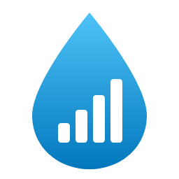
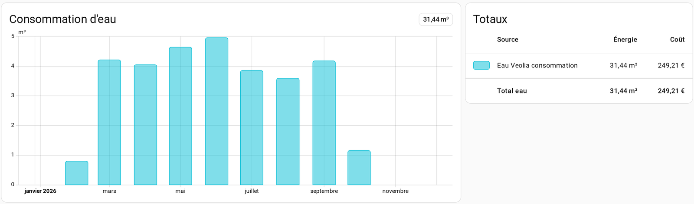
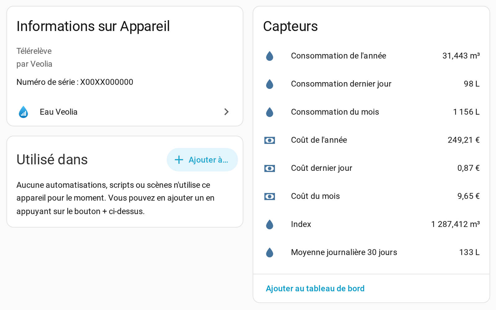
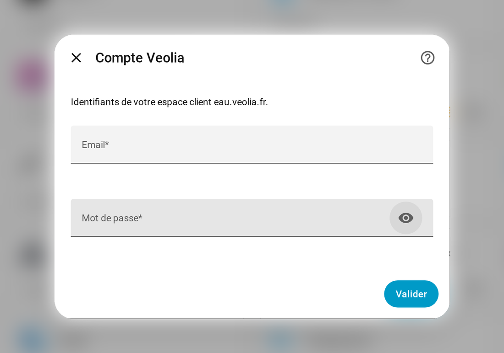
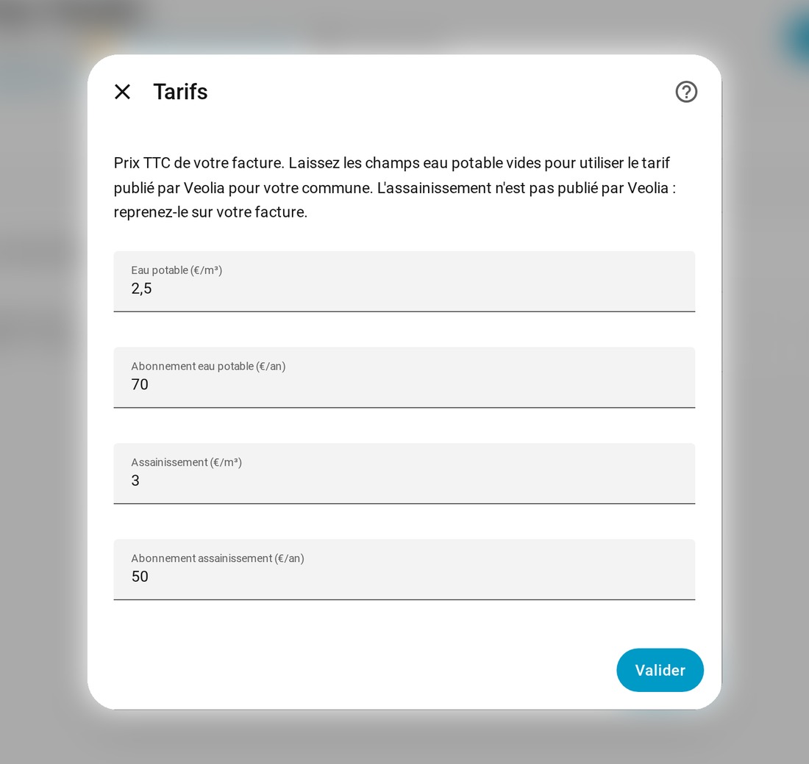

<p align="center">
  
</p>

<h1 align="center">Eau Veolia pour Home Assistant</h1>

<p align="center">
  Votre consommation d'eau Veolia et son coût, jour par jour, dans Home Assistant.
</p>

<p align="center">
  <a href="https://hacs.xyz"></a>
  <a href="https://github.com/casi-3/ha-eau-veolia/releases"></a>
  
  <a href="LICENSE"></a>
</p>

<p align="center">
  <a href="https://my.home-assistant.io/redirect/hacs_repository/?owner=casi-3&repository=ha-eau-veolia&category=integration"></a>
</p>



## ✨ Points forts

- 💧 **Historique complet** : au premier lancement, tout l'historique depuis le début de l'abonnement est importé, y compris pour un abonnement souscrit en cours d'année.
- 📅 **Les bons jours** : Veolia publie les relevés avec un jour de retard. Chaque relevé est enregistré à la date où l'eau a réellement été consommée.
- 💶 **Coût de l'eau** : le tarif de l'eau potable est récupéré automatiquement pour votre commune, l'assainissement se saisit en deux champs. Le coût apparaît jour par jour dans le tableau Énergie.
- 🧱 **Aucune dépendance** : tout le code tient dans le dossier de l'intégration, rien n'est installé par pip. Une mise à jour de Home Assistant ne peut pas la casser.
- 🛟 **Robuste** : si Veolia est en panne, l'intégration réessaie plus tard. Elle ne redemande le mot de passe que si Veolia le refuse vraiment.

## 📊 Ce que vous obtenez

Un appareil **Compteur d'eau** avec ses capteurs :



| Capteur | Unité | Description |
| --- | --- | --- |
| Index | m³ | Index du compteur à la fin du dernier jour relevé |
| Consommation dernier jour | L | Consommation du dernier jour relevé (en général la veille) |
| Consommation du mois | L | Total du mois en cours |
| Consommation de l'année | m³ | Total de l'année en cours |
| Moyenne journalière 30 jours | L | Moyenne quotidienne sur les 30 derniers jours |
| Coût dernier jour | € | Coût du dernier jour relevé, abonnements inclus |
| Coût du mois | € | Coût du mois en cours |
| Coût de l'année | € | Coût de l'année en cours |
| Dernier relevé | date | Date du dernier relevé disponible (JJ/MM/AAAA) |

Le capteur **Coût dernier jour** détaille aussi la part eau potable, la part assainissement et les tarifs utilisés.

L'intégration crée enfin deux statistiques pour le tableau de bord Énergie : **Eau Veolia consommation** et **Eau Veolia coût**.

## 📦 Installation

### Avec HACS (recommandé)

Cliquez sur le bouton ci-dessous, puis sur **Télécharger** et redémarrez Home Assistant.

<a href="https://my.home-assistant.io/redirect/hacs_repository/?owner=casi-3&repository=ha-eau-veolia&category=integration"></a>

<details>
<summary>Sans le bouton</summary>

1. Dans HACS, ouvrez le menu en haut à droite puis **Dépôts personnalisés**.
2. Ajoutez `https://github.com/casi-3/ha-eau-veolia` avec le type **Intégration**.
3. Installez **Eau Veolia** puis redémarrez Home Assistant.

</details>

### Manuellement

1. Copiez le dossier `custom_components/eau_veolia` dans le dossier `custom_components` de votre configuration Home Assistant.
2. Redémarrez Home Assistant.

## 🔑 Configuration

<a href="https://my.home-assistant.io/redirect/config_flow_start/?domain=eau_veolia"></a>

Saisissez l'email et le mot de passe de votre espace client [eau.veolia.fr](https://www.eau.veolia.fr).

<p align="center">
  
</p>

Le premier chargement importe tout l'historique, ce qui prend quelques secondes. Les données sont ensuite mises à jour toutes les 3 heures.

## 💶 Tarifs

Une facture d'eau comporte deux parts : l'**eau potable** (production et distribution) et l'**assainissement** (collecte et traitement des eaux usées). Chacune a un prix au m³ et un abonnement fixe. Le volume d'eaux usées n'est pas mesuré : il est égal au volume d'eau potable relevé par le compteur.

Les tarifs se règlent dans **Paramètres > Appareils et services > Eau Veolia > ⚙️ Configurer**. Tous les prix sont TTC.

<p align="center">
  
</p>

| Champ | Si laissé vide |
| --- | --- |
| Eau potable (€/m³) | ✅ Tarif publié par Veolia pour votre commune, mis à jour automatiquement |
| Abonnement eau potable (€/an) | ✅ Abonnement publié par Veolia pour votre commune |
| Assainissement (€/m³) | ❌ Non compté, à reprendre sur votre facture |
| Abonnement assainissement (€/an) | ❌ Non compté, à reprendre sur votre facture |

<details>
<summary>📄 Trouver ses tarifs sur une facture Veolia</summary>

Les prix se trouvent dans la partie **Votre facture détaillée**, colonne **Prix unitaire** (hors taxes).

**Assainissement (€/m³)** : additionnez les prix au m³ de la rubrique « Collecte et dépollution des eaux usées » (consommation et fonds de renouvellement) et la ligne « Performance systèmes assainissement collectif » des organismes publics, puis multipliez par 1,10 (TVA à 10 %).

**Abonnement assainissement (€/an)** : additionnez les abonnements de la même rubrique et multipliez par 1,10. S'ils sont facturés par semestre, multipliez encore par 2.

**Eau potable**, si vous voulez coller exactement à votre facture : même calcul avec la rubrique « Potabilisation et distribution de l'eau » et les lignes eau potable des organismes publics, avec une TVA à 5,5 % (× 1,055). Le tarif publié par Veolia peut en effet différer légèrement de votre facture (tranches, arrondis).

</details>

Les abonnements sont répartis sur chaque jour de l'année. Quand vous modifiez les tarifs, tout l'historique de coût est recalculé avec les nouveaux prix.

## ⚡ Tableau de bord Énergie

<a href="https://my.home-assistant.io/redirect/config_energy/"></a>

1. Dans **Consommation d'eau**, ajoutez une source et choisissez **Eau Veolia consommation**.
2. Pour le coût, choisissez l'option qui utilise une entité suivant le coût total, puis **Eau Veolia coût**.

> [!TIP]
> Choisissez bien ces statistiques et non les capteurs : avec un capteur, les valeurs apparaîtraient un jour trop tard.

> [!NOTE]
> Veolia publie la consommation d'une journée le lendemain : la journée en cours affiche donc toujours 0. Passez en vue semaine ou mois pour voir vos données.

## ⚙️ Fonctionnement

L'intégration se connecte comme le site Veolia : authentification par email et mot de passe, puis lecture des relevés journaliers et mensuels de l'abonnement. Seules des requêtes de lecture sont envoyées, rien n'est modifié sur votre compte. Le tarif de l'eau potable vient de l'annuaire public des communes de Veolia, consulté une fois par jour.

À chaque mise à jour, seuls les derniers jours sont relus (avec quelques jours de recouvrement pour prendre en compte d'éventuelles corrections de Veolia), puis les statistiques sont réécrites pour ces jours.

## 🚧 Limites

- Seul le portail principal `eau.veolia.fr` est pris en charge. Les portails régionaux qui utilisent un autre système de connexion ne fonctionnent pas.
- Si plusieurs abonnements sont rattachés au même compte, seul le premier est suivi.
- Le coût est calculé avec les tarifs actuels. Si vos tarifs changent, mettez à jour les options : l'historique sera recalculé avec les nouveaux prix.
- Un remplacement de compteur (remise à zéro de l'index) n'est pas encore géré.

## 🛠️ Dépannage

Pour obtenir des journaux détaillés, ajoutez dans `configuration.yaml` :

```yaml
logger:
  logs:
    custom_components.eau_veolia: debug
```

Un problème ou une idée ? [Ouvrez une issue](https://github.com/casi-3/ha-eau-veolia/issues).

## 🙏 Crédits

Développé par **casi-3 (casi3)**. Merci de conserver ce crédit en cas de réutilisation ou de modification.

Ce projet n'est pas affilié à Veolia.

## 📜 Licence

[MIT](LICENSE)
